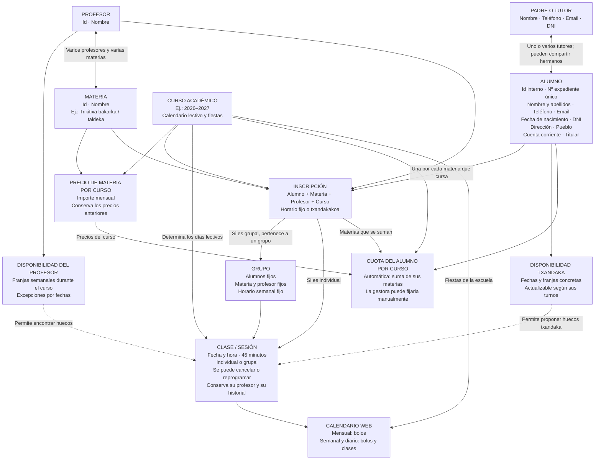

# Escuela: diseño de modelos

Diseño funcional acordado, pendiente de implementación. El diagrama describe
relaciones y responsabilidades; no es todavía un esquema físico de base de datos.

## Diagrama

## Modelos y parámetros

Los siguientes son campos y relaciones del diseño funcional. Los nombres técnicos,
los tipos concretos de base de datos, las claves internas de los modelos auxiliares
y la obligatoriedad de cada dato se concretarán al implementar. No se añaden aquí
datos personales distintos de los solicitados. Las fechas, horas e importes se
describen por su significado, sin imponer todavía un formato de almacenamiento.

### Alumno

| Parámetro | Contenido y regla |
| --- | --- |
| Id interno | Identificador estable del alumno, independiente del expediente. |
| Número de expediente | Referencia única visible para la gestora; normalmente se mantiene entre cursos. |
| Nombre y apellidos | Nombre y apellidos del alumno. |
| Teléfono | Teléfono de contacto. |
| Fecha de nacimiento | Fecha de nacimiento; permite distinguir menores y mayores de edad. |
| DNI | DNI del alumno. |
| Dirección | Dirección del alumno. |
| Pueblo | Pueblo del alumno. |
| Email | Correo electrónico del alumno. |
| Cuenta corriente | Cuenta para el cobro. |
| Titular de la cuenta | Titular de la cuenta corriente. |
| Padres o tutores | Relación con uno o varios responsables en el caso de los menores. |
| Inscripciones | Materias que cursa, con su profesor y organización horaria en cada curso. |
| Cuota por curso | Relación con el cálculo automático o el importe manual de ese curso. |

Materia, profesor y cantidad a cobrar se consultan mediante las inscripciones y la
cuota correspondiente; no se duplican como datos independientes del alumno.

### Padre o tutor

| Parámetro | Contenido y regla |
| --- | --- |
| Nombre | Nombre del padre, madre o tutor. |
| Teléfono | Teléfono de contacto. |
| Email | Correo electrónico de contacto. |
| DNI | DNI del responsable. |
| Alumnos asociados | Uno o varios alumnos; permite compartir los mismos datos entre hermanos. |

Un alumno puede tener varios responsables, según su situación familiar. No se han
definido datos de custodia ni otras categorías adicionales.

### Profesor

| Parámetro | Contenido y regla |
| --- | --- |
| Id | Identificador del profesor. |
| Nombre | Nombre del profesor. |
| Disponibilidad | Franjas habituales y excepciones para fechas concretas. |
| Materias que imparte | Relación con una o varias materias; cada materia admite varios profesores. |

El horario ocupado se obtiene de las clases asignadas. La disponibilidad indica
cuándo puede impartir clase y no constituye por sí sola una sesión del calendario.

### Disponibilidad del profesor

| Parámetro | Contenido y regla |
| --- | --- |
| Profesor | Profesor al que pertenece la disponibilidad. |
| Curso académico | Curso durante el que se aplica la disponibilidad habitual. |
| Franjas semanales | Día de la semana y hora de inicio y fin de cada franja; puede haber varias en un día. |
| Excepciones por fecha | Fecha concreta y franjas disponibles o periodos de indisponibilidad que alteran la pauta habitual. |

El gestor puede modificarla. Cancelar las clases de una tarde concreta no modifica
por sí mismo el horario del resto de semanas. El efecto sobre sesiones ya asignadas
debe ser explícito: cancelarlas o reprogramarlas conservando su registro.

### Materia

| Parámetro | Contenido y regla |
| --- | --- |
| Id | Identificador de la materia. |
| Nombre | Nombre de la materia, por ejemplo Trikitixa bakarka o Trikitixa taldeka. |
| Profesores | Profesores que pueden impartirla. |
| Precios por curso | Relación con su importe mensual en cada curso académico. |

El horario pertenece a las clases, no a la materia. Las modalidades individual y
grupal se organizan como materias distintas, con sus respectivos precios.

### Curso académico

| Parámetro | Contenido y regla |
| --- | --- |
| Curso | Referencia del curso, por ejemplo 2026–2027. |
| Inicio de clases | Fecha concreta de comienzo en septiembre. |
| Fin de clases | Fecha concreta de finalización en junio. |
| Calendario lectivo | Días lectivos, vacaciones, festivos y fiestas de la escuela. |
| Datos del curso | Inscripciones, disponibilidad del profesorado, grupos, horarios, sesiones, precios y cuotas correspondientes a ese año. |

Se conserva el historial al abrir un curso nuevo. Alumnos y profesores mantienen su
identidad entre cursos.

### Calendario lectivo y fiestas

| Parámetro | Contenido y regla |
| --- | --- |
| Curso académico | Curso al que corresponde el calendario. |
| Fechas o periodos sin clase | Vacaciones y festivos; en principio no se asignan clases esos días. |
| Fiestas de la escuela | Fecha y evento de la fiesta; sustituye las clases habituales. |
| Tratamiento del fin de semana | Sin clases habituales por defecto, pero admite sesiones puntuales. |

El gestor podrá editar el calendario. La representación técnica de días, periodos
y eventos de fiesta queda por concretar; no implica que todo se guarde en una tabla.

### Precio de materia por curso

| Parámetro | Contenido y regla |
| --- | --- |
| Materia | Materia a la que se aplica el precio. |
| Curso académico | Curso al que corresponde el importe. |
| Importe mensual | Precio mensual de esa materia durante ese curso. |

Un precio de un curso nuevo no sustituye el de cursos anteriores. Por ejemplo,
Trikitixa conserva 50 € para 2025–2026 y 60 € para 2026–2027.

### Inscripción

Representa una materia que cursa un alumno durante un curso académico.

| Parámetro | Contenido y regla |
| --- | --- |
| Alumno | Alumno inscrito. |
| Materia | Materia que cursa. |
| Profesor | Profesor asignado para esa materia. |
| Curso académico | Curso al que pertenece la inscripción. |
| Organización horaria | Fija o txandakakoa para esa materia concreta. |
| Grupo | Relación con el grupo cuando la clase es grupal. |
| Horario fijo | Día de la semana y hora de inicio para clases individuales fijas; en las grupales lo determina el grupo. |
| Periodo de inscripción | Fechas de alta y, cuando corresponda, baja, para reflejar incorporaciones y bajas durante el curso. |

Las clases fijas son semanales y duran 45 minutos. Un alumno puede combinar materias
fijas y txandaka. El profesor se mantiene al reprogramar una sesión. Las fechas de
alta y baja no establecen todavía una regla de prorrateo de cuotas.

### Disponibilidad del alumno txandakakoa

| Parámetro | Contenido y regla |
| --- | --- |
| Alumno | Alumno al que corresponde la disponibilidad. |
| Fecha | Día concreto en que puede asistir. |
| Franjas disponibles | Hora de inicio y fin de cada franja; actualizables según sus turnos. |

La web cruza estas franjas con la disponibilidad y las clases ocupadas de su profesor
para proponer sesiones de 45 minutos para la inscripción correspondiente. La gestora
elige y confirma el hueco. No se presupone una disponibilidad semanal permanente.

### Grupo

| Parámetro | Contenido y regla |
| --- | --- |
| Curso académico | Curso al que pertenece el grupo. |
| Materia | Materia fija del grupo. |
| Profesor | Profesor fijo del grupo. |
| Alumnos | Integrantes fijos, vinculados mediante sus inscripciones. |
| Horario semanal | Día de la semana y hora de inicio habituales. |

Las sesiones grupales duran 45 minutos. Los grupos no son txandakakoak. Sus relaciones
de materia y profesor deben coincidir con las de las inscripciones que los integran.

### Clase o sesión

| Parámetro | Contenido y regla |
| --- | --- |
| Curso académico | Curso al que corresponde la sesión. |
| Inscripción o grupo | Inscripción individual o grupo que recibe la clase. |
| Materia | La de la inscripción o grupo correspondiente. |
| Profesor | El de la inscripción o grupo; se mantiene al reprogramar. |
| Alumnos | El alumno de la inscripción individual o los integrantes del grupo. |
| Fecha | Fecha concreta de la sesión. |
| Hora de inicio | Hora asignada a la sesión. |
| Duración | Siempre 45 minutos; la hora de fin se obtiene de ella. |
| Situación e historial | Permite conservar la sesión asignada, su cancelación y sus cambios de fecha u hora. |

Materia, profesor y alumnos son relaciones de la sesión; su inclusión aquí no obliga
a duplicar columnas. La cancelación o reprogramación de una sesión concreta conserva
el resto de la pauta semanal. Los detalles técnicos del registro histórico quedan
pendientes de implementación.

### Cuota del alumno por curso

| Parámetro | Contenido y regla |
| --- | --- |
| Alumno | Alumno al que corresponde la cuota total. |
| Curso académico | Curso para el que se calcula. |
| Modalidad de cálculo | Automática o manual; siempre automática al iniciar un curso. |
| Importe automático | Suma de los precios de sus materias en el curso correspondiente. |
| Importe manual | Cantidad fijada por la gestora para una excepción. |
| Cantidad a cobrar | Importe automático o manual según la modalidad vigente. |

Los importes calculados se describen como resultados funcionales, sin exigir que se
almacenen como columnas independientes. Una cuota manual se mantiene durante el curso
aunque cambien las materias o sus precios. Al iniciar otro curso se vuelve al cálculo
automático y la gestora revisa las excepciones. Se conserva el historial anterior.
No se han solicitado motivos de descuento ni seguimiento de pagos.

### Calendario web

Es una vista conjunta de los datos, no un modelo adicional con una copia de las clases.

| Vista | Contenido |
| --- | --- |
| Mensual | Bolos; no necesita mostrar clases. |
| Semanal | Bolos y sesiones de la escuela con fecha y hora asignadas. |
| Diaria | Bolos y sesiones de la escuela con fecha y hora asignadas. |

Las fiestas de la escuela se representan como eventos. La disponibilidad se utiliza
para organizar y proponer clases; no se presenta como si fuera una clase asignada.

## Reglas acordadas

- El alumno tiene un id interno estable y un número de expediente único aparte.
  Un menor puede tener uno o varios padres o tutores asociados; un mismo tutor
  puede estar asociado a varios alumnos.
- Un profesor puede impartir varias materias y una materia puede ser impartida
  por varios profesores. No se gestionan aulas ni espacios.
- Inscripción representa cada materia que cursa un alumno dentro de un curso.
  Un alumno puede cursar varias materias y combinar horario fijo y txandaka.
- Todas las clases duran 45 minutos. Las fijas son semanales y se generan en
  días lectivos. Los grupos mantienen alumnos, materia, profesor y horario fijos.
- La disponibilidad habitual del profesor se mantiene durante el curso. El gestor
  puede modificarla y añadir excepciones por fechas concretas.
- La disponibilidad de los txandakakoak se registra por fechas y franjas horarias
  concretas y puede cambiar según sus turnos. La web propone huecos compatibles
  de 45 minutos que estén libres para el profesor y el alumno; la gestora elige
  y confirma la sesión.
- Se pueden asignar sesiones puntuales en sábado y domingo. Vacaciones, festivos
  y fiestas de la escuela son, en principio, días sin clases. El calendario debe
  distinguir ambos casos aunque el documento de referencia use el mismo color.
- El gestor puede cancelar o reprogramar sesiones concretas sin cambiar el horario
  habitual. Se conserva su registro y siempre se mantiene el mismo profesor.
- El calendario mensual conserva los bolos; las nuevas vistas semanal y diaria
  muestran bolos y clases. Las fiestas de la escuela aparecen como eventos.
- El curso académico conserva el historial de inscripciones, horarios, clases y
  cuotas. Los datos del alumno y del profesor se mantienen entre cursos.
- Cada materia tiene su precio mensual por curso: por ejemplo, 50 € en
  2025–2026 y 60 € en 2026–2027, conservando ambos. Las modalidades individual
  y grupal son materias distintas, como Trikitixa bakarka y Trikitixa taldeka.
- La cuota mensual total del alumno empieza automáticamente cada curso como
  suma de los precios de sus materias. La gestora puede fijar una cuota manual.
  Una cuota manual no se modifica por cambios de materias o precios durante ese
  curso; al empezar el siguiente se vuelve al cálculo automático y la gestora
  revisa las excepciones.
- Las clases van de septiembre a junio y se cobran a mes vencido, de octubre a
  julio: octubre corresponde a septiembre y julio a junio. Solo se calcula la
  cuota; no se registran pagos ni mensualidades pendientes.
- Se permiten altas y bajas de materias durante el curso, conservando el historial.

## Referencia del curso 2026–2027

El calendario facilitado y las aclaraciones de la gestora establecen:

- Inicio de clases: 10 de septiembre de 2026.
- Fin de clases: 18 de junio de 2027.
- Fiestas: 23 de enero y 3 de junio de 2027. Sustituyen las clases habituales;
  el 3 de junio se reúne todo el alumnado en la fiesta de la escuela.
- El calendario lectivo de cada curso será editable desde la web.

## Reglas pendientes de confirmar

- Número de sesiones que corresponde a los txandakakoak.
- Cálculo de la cuota ante altas o bajas de materias a mitad de mes.

Hasta aclarar la primera regla, la web puede proponer huecos y la gestora decidir
las sesiones, sin calcular si faltan o sobran. La segunda regla no tiene todavía
un criterio de cobro acordado.
